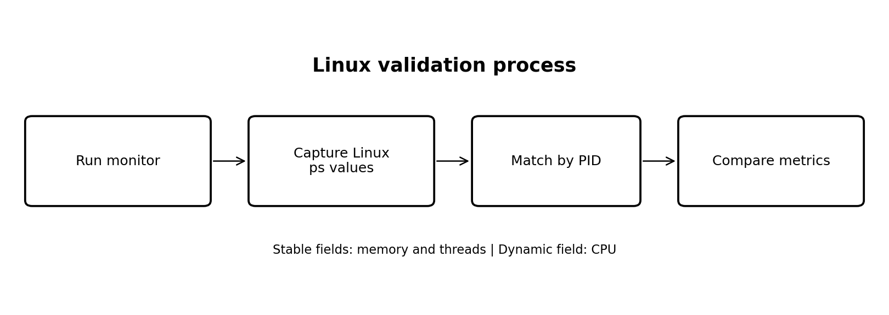
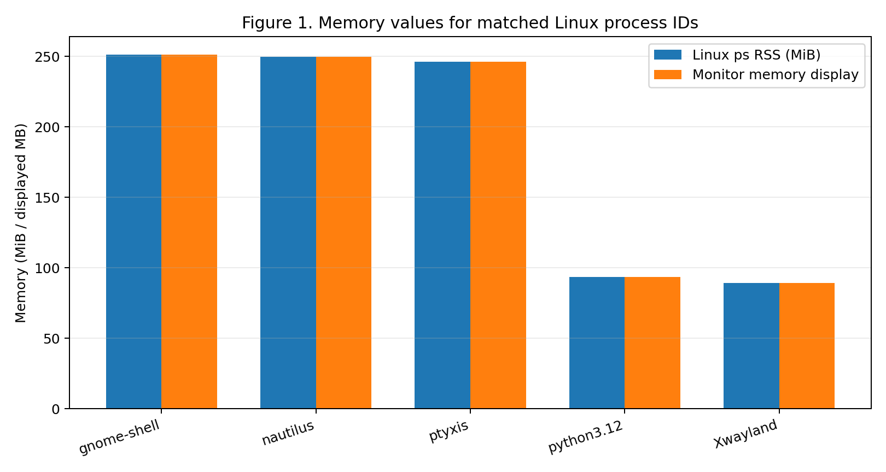
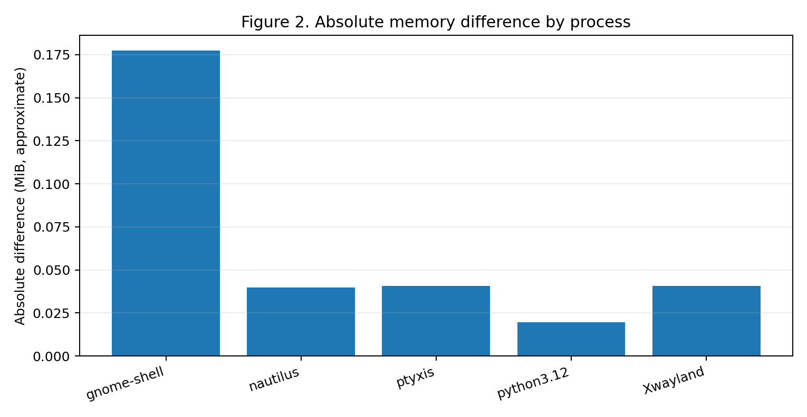
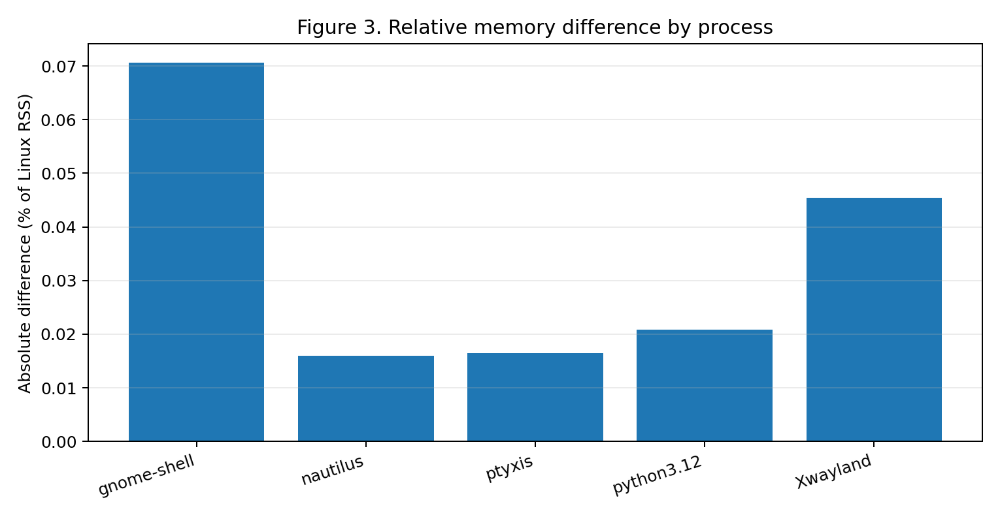
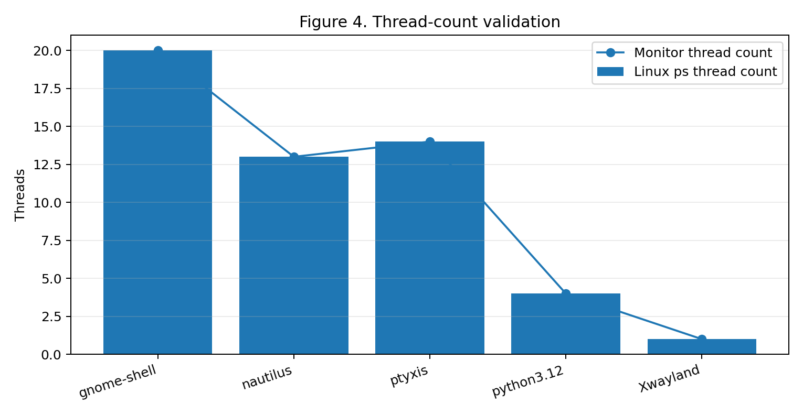
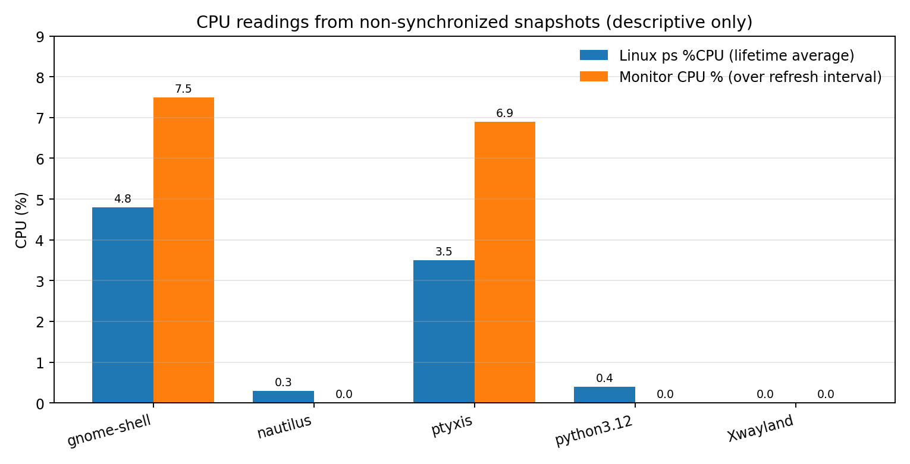
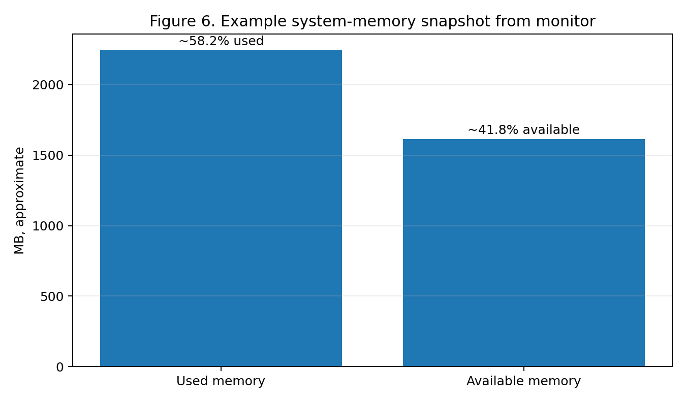

# Mini Process Monitor

A lightweight, terminal-based process monitor written in **Python 3** with **psutil**, inspired by Linux `top`/`htop` and the Windows Task Manager. It shows real processes, CPU, memory and thread information, and lets you search, sort, inspect and (after confirmation) request termination of a process.

> **Project type:** Operating Systems course project (team of 10).
> **Important distinction:** this is a *monitoring* tool. It observes what the operating system reports; it does **not** implement a CPU scheduler, memory manager or kernel process manager.

## At a glance

| Item | Status |
|---|---|
| Language / library | Python 3 (3.10+ recommended), `psutil` |
| Interface | Interactive terminal menu (no GUI, web server, database or internet needed) |
| Target platforms | Windows 11 and Linux, same source code |
| Verified on | **Ubuntu Linux in VMware Workstation** (recorded session and screenshots) |
| Automated tests | **50 tests, all passed** in the recorded Linux run (`Ran 50 tests in 0.027s`, `OK`) |
| Windows 11 results | **Not recorded yet** - see the [Windows checklist](#windows-11-validation-checklist) |
| Memory accuracy (5-process sample) | Mean absolute difference **0.064 MiB** (**0.034 %**) versus `ps` RSS |
| Thread-count accuracy (5-process sample) | **5 / 5 exact matches** (plus the controlled `sleep` process) |
| CPU accuracy | **Not established** - the recorded snapshots are not comparable (explained below) |

## Contents

1. [Project summary](#1-project-summary)
2. [Features](#2-features)
3. [Architecture and design](#3-architecture-and-design)
4. [Safe termination](#4-safe-termination)
5. [Installation](#5-installation)
6. [Running and using the program](#6-running-and-using-the-program)
7. [Understanding the metrics](#7-understanding-the-metrics)
8. [Testing](#8-testing)
9. [Linux results and analysis](#9-linux-results-and-analysis)
10. [Limitations and future work](#10-limitations-and-future-work)
11. [Repository structure](#11-repository-structure)
12. [Team and workflow](#12-team-and-workflow)
13. [Troubleshooting](#13-troubleshooting)
14. [Contributing, license and references](#14-contributing-license-and-references)

---

## 1. Project summary

### Problem
An operating system runs hundreds of processes at once. Concepts such as process IDs, threads, CPU utilization, memory use and process termination are abstract when only read in a textbook. Users and students need a small tool that makes them visible without a full system-management interface.

### Objectives
1. List real active processes with PID, name, status and thread count.
2. Show system-wide CPU and memory, and per-process CPU and memory.
3. Refresh automatically (default about two seconds).
4. Search by name or PID, and sort by CPU, memory, PID or name.
5. Show details of one selected process.
6. Request termination safely: confirmation first, clear errors, no privilege escalation.
7. Survive inaccessible, vanished or changing processes.
8. Run the same core code on Windows 11 and Linux.
9. Teach OS concepts through the implementation, tests, report and demonstration.

### Scope
| Included | Not included |
|---|---|
| Process table and system summary | A new CPU scheduler or changes to the OS scheduler |
| CPU, memory, status, thread information | Kernel modules, drivers, custom system calls |
| Refresh, search, sort, details | GUI or web dashboard |
| Confirmed termination request (force-kill only with a separate confirmation, as designed) | Remote monitoring, process injection, stealth or privilege escalation |
| Automated tests, setup guides, documentation | Automatic termination based on CPU/memory thresholds |

### Development approach
The code is written on **Windows 11 with VS Code**, then cloned into **Linux** with its own virtual environment for testing. Linux testing measures the *Linux* processes; it does not monitor the Windows host.

---

## 2. Features

| Requirement | Feature | Notes |
|---|---|---|
| FR-01 | **Process table** | PID, name, status, CPU %, memory (MB), memory %, thread count |
| FR-02 | **CPU monitoring** | System CPU, logical CPU count, per-process CPU; first sample may show as *sampling/unavailable* |
| FR-03 | **Memory monitoring** | Used / total / available memory and %, kept separate from per-process memory |
| FR-04 | **Live refresh** | Periodic refresh (two seconds in the tested build); `Ctrl+C` stops it and returns to the menu |
| FR-05 | **Search** | Case-insensitive partial name search and PID search; blank input clears the search |
| FR-06 | **Sorting** | `cpu`, `memory`, `pid`, `name` |
| FR-07 | **Process details** | PID, name, status, parent PID, threads, creation time, CPU, memory, user, executable, command line (where permitted) |
| FR-08 | **Safe termination** | Confirmation prompt, self-protection, graceful request, error handling |
| FR-09 | **Resilience** | One inaccessible or vanished process must not crash the program |
| FR-10 | **Portability** | Same code for Windows and Linux; differences documented below |
| FR-11, 12 | **Tests and docs** | `unittest` suite; setup, usage, testing and limitations documented |

Cross-platform note: Python and psutil support both systems, but process visibility, permissions and status names differ by OS. **All results in this README come from Ubuntu Linux.**

---

## 3. Architecture and design

A layered design keeps the user interface, the control flow, data collection and actions separate.

```
                +-----------------------------+
                |        User / Operator       |
                +--------------+--------------+
                               |
                +--------------v--------------+
                |  Terminal UI  (display.py)   |   tables, menu, prompts, messages
                +--------------+--------------+
                               |
                +--------------v--------------+
                |  Controller   (main.py)      |   main loop, refresh, routing, exit
                +------+---------------+------+
                       |               |
        +--------------v----+   +------v---------------+
        | Monitoring        |   | Actions              |
        | monitor.py        |   | actions.py           |
        | process list, CPU,|   | search, sort,        |
        | memory, system    |   | details, terminate   |
        +--------------+----+   +------+---------------+
                       |               |
                +------v---------------v------+
                |  psutil + Python stdlib      |
                +--------------+--------------+
                               |
                 +-------------+-------------+
                 |  Windows 11   |   Linux    |
                 +---------------+------------+
```

| Layer | Owns | Must not do |
|---|---|---|
| UI (`display.py`) | Render tables, prompts, messages | Access the OS for process data |
| Controller (`main.py`) | Refresh loop, menu routing, exit | Duplicate collection logic |
| Monitoring (`monitor.py`) | Collect process and system metrics | Ask the user for input |
| Actions (`actions.py`) | Search, sort, details, termination | Kill silently or elevate privileges |
| Tests (`tests/`) | Verify behaviour and error handling | Terminate arbitrary real processes |

### Process record (data shape)
Every table row uses one consistent record. Missing values are `None` internally and shown as `N/A` only when displayed.

```python
{
  "pid": int,              # process ID
  "name": str,             # or an "unavailable" marker
  "status": str,           # displayable status
  "cpu_percent": float | None,
  "memory_mb": float | None,
  "memory_percent": float | None,
  "thread_count": int | None,
}
```

### CPU sampling rule
CPU percentage is a measurement **over time**, not an instant. The first `psutil` reading for a process only starts the measurement and can be `0.0` or meaningless, so the interface shows *sampling* until a valid interval has elapsed and avoids repeated blocking calls for every row.

---

## 4. Safe termination

Process termination is the risky operation, so it follows these rules:

1. Show the selected **process name and PID** and require explicit confirmation.
2. **Protect the monitor's own process** from termination.
3. Re-read the process identity as close as practical to the request (reduces the **PID-reuse** race).
4. Use `psutil` `terminate()` for a normal request and wait briefly for it to exit.
5. If force termination is offered (`kill()`), require a **separate** explicit confirmation. It is never automatic.
6. Handle `AccessDenied`, `NoSuchProcess`, `ZombieProcess`, timeouts and OS permission errors.
7. **Never** use `sudo`, run as administrator, or otherwise elevate privileges. The program *requests*; the **operating system decides**.
8. Do not test by terminating system services, PID 0/1, or desktop/session processes. Automated tests use mocks or a disposable child process.

A termination request is not proof that a process exited. Verify the outcome where the API allows it.

---

## 5. Installation

### Requirements
* Python 3.10 or a compatible version supported by your installed dependencies
* `pip` and `psutil`
* A terminal; Git if cloning

### 1. Get the code
```bash
git clone https://github.com/jeetsaha1/Mini-Process-Monitor.git
cd Mini-Process-Monitor
git branch -a            # only if the default branch differs
```

### 2. Windows 11 (PowerShell in VS Code)
```powershell
py --version
py -m venv .venv
.\.venv\Scripts\Activate.ps1
python -m pip install --upgrade pip
python -m pip install -r requirements.txt
```
* If activation is blocked, use Command Prompt: `.venv\Scripts\activate.bat` (avoid changing machine-wide policy without understanding it).
* If `py` is not found, try `python --version`, or install Python from python.org and tick **Add python.exe to PATH**.

### 3. Linux
```bash
python3 --version
python3 -m venv .venv
source .venv/bin/activate
python -m pip install --upgrade pip
python -m pip install -r requirements.txt
```
If `venv` is missing on Ubuntu/Debian: `sudo apt update && sudo apt install python3-venv` (use `sudo` only to install that package, never to run the monitor). **Do not copy a Windows `.venv` to Linux**; create a new one.

If `requirements.txt` is absent, run `python -m pip install psutil`. Verify with `python --version` and `python -m pip show psutil`.

---

## 6. Running and using the program

From the repository root with the virtual environment active:

```bash
python main.py
```

The first CPU sample may show as *sampling/unavailable*; refresh to get a valid reading.

### Menu (as used in the tested build)

| Option | Action | Instructions |
|---|---|---|
| `1` | Refresh process table | Collect and display current information |
| `2` | Search processes | Enter a name (case-insensitive, partial) or a PID; blank input clears the search |
| `3` | Sort process table | Enter `cpu`, `memory`, `pid` or `name` |
| `4` | View process details | Enter the PID to inspect |
| `5` | Terminate process | Enter a PID and read the confirmation carefully |
| `6` | Live auto-refresh | Refreshes periodically; press `Ctrl+C` to stop and return to the menu |
| `7` | Exit | Close the application |

Exact menu wording may vary by revision. Leave with option `7`, or `Ctrl+C` where documented.

---

## 7. Understanding the metrics

| Metric | Meaning | Caution |
|---|---|---|
| **System CPU %** | Busy share of all logical CPUs over the last measuring interval | Not an instantaneous value |
| **Process CPU %** | CPU time a process used during the measuring interval | Depends on interval and on whether the value is scaled by core count; first sample is not meaningful |
| **System memory** | Total, available, used and used % of physical RAM | "Used" is calculated slightly differently on Windows and Linux |
| **Process memory** | Resident memory (RSS): physical RAM the process currently occupies | Shared memory can be counted in several processes, so rows do not add up exactly to system "used" |
| **Threads** | Number of threads in the process | A thread is *not* a process |
| **PID vs TID** | PID names a process; TID names a thread | Different numbers; PIDs are reused after a process ends |
| **Status** | Process state as reported by the OS | Linux has many states (`running`, `sleeping`, `disk-sleep`, `stopped`, `zombie`, `idle`...); Windows reports far fewer |

Values are snapshots and change quickly. Some fields (path, command line, memory, threads) can be `N/A` for protected or other-user processes. This is expected and safe. Command lines may contain private data, so hide them in screenshots.

### Platform differences worth knowing
* Permissions and visibility differ between Linux and Windows.
* Status names and process/thread details do not map one-to-one.
* On Linux, `terminate()` sends `SIGTERM` (a polite request) and `kill()` sends `SIGKILL`. On Windows, `psutil` implements both with `TerminateProcess`, which is already forceful, so a "force" step adds nothing there.
* Termination can fail for protected services or processes owned by another user.

---

## 8. Testing

```bash
python -m unittest discover -s tests -v
python -m py_compile main.py process_monitor/actions.py     # syntax check
```
Run from the repository root, with the virtual environment active. The command is the same on Windows and Linux.

### Recorded automated result (Ubuntu)
```text
Ran 50 tests in 0.027s

OK
```
**50 discovered tests passed in that recorded run.** The visible tests cover safe termination, terminal formatting, dashboard and refresh behaviour, menu/detail presentation, system summaries and process/system-statistics helpers. The output gives **no coverage percentage**. Re-run the suite on the current checkout to confirm its present state.

### Test plan and evidence status

| ID | Area | Method | Evidence in the recorded Linux session |
|---|---|---|---|
| T-01 | Process listing | Real collector on the test machine | Observed: dashboard and process table rendered (about 351 processes at one point) |
| T-02 | CPU metrics | Valid and warm-up readings | Warm-up behaviour documented; not separately evidenced; CPU accuracy not established |
| T-03 | Memory metrics | System and process fields, units | Observed: five-process memory match and system snapshots |
| T-04 | Search by name | Mixed-case query | Observed: `python` search returned matching rows |
| T-05 | Search by PID | Valid and invalid PID text | Observed: five PIDs searched; invalid-input handling not shown |
| T-06 | Sorting | CPU / memory / PID / name | Observed: sort by memory; other keys not shown |
| T-07 | Vanished process | Mocked `NoSuchProcess` | No recorded evidence |
| T-08 | Permission denied | Mocked `AccessDenied` | No recorded evidence |
| T-09 | Termination | Mock or disposable process | Observed: `sleep` (PID 7446) terminated after confirmation; automated termination tests pass |
| T-10 | Self-protection | Select the monitor's own PID | Implemented by design; attempt not recorded |
| T-11 | Refresh and exit | Live refresh, documented exit | Observed: `Ctrl+C` returned cleanly to the menu |
| T-12 | Portability | Clean environment on both OSes | **Linux only.** Windows not yet recorded |

### Windows 11 validation checklist
- [ ] Fresh clone, `.venv` created, dependencies installed
- [ ] `python main.py` starts and shows real processes
- [ ] CPU and memory labelled and plausible versus Task Manager
- [ ] Search, sort, details work
- [ ] Access-denied and vanished-process cases handled
- [ ] Termination of a disposable process (e.g. Notepad) works only after confirmation
- [ ] `python -m unittest discover -s tests -v` result recorded
- [ ] Screenshots captured

---

## 9. Linux results and analysis

### 9.1 Environment and method
* **System:** Ubuntu Linux in VMware Workstation. **Application:** this monitor (Python, psutil, terminal UI).
* **Reference tool:** Linux `ps`. **Matching key:** PID. RSS in `ps` is in KiB (1024-byte units) and was converted with `KB / 1024`.
* **Evidence:** screenshots and terminal output supplied by the project author. *No new measurements were taken while preparing this document.* Values are transcribed as displayed.



Commands shown in the evidence:
```bash
python -m unittest discover -s tests -v
sleep 300 & echo "Test PID: $!"
ps -p 7612 -o pid,comm,stat,%cpu,rss,nlwp
ps -eo pid,comm,%cpu,rss,nlwp --sort=-rss | head -n 11
```

### 9.2 Verdict

| Question | Answer | Confidence |
|---|---|---|
| Does the application run and operate on Ubuntu? | **Yes** | Directly observed |
| Do the main features work (search, sort, details, terminate, live refresh)? | **Yes**, in the observed runs | Observed, small sample |
| Did the automated suite pass? | **Yes, 50 / 50** | Recorded output |
| Do thread counts match `ps`? | **Yes, 5 / 5, plus the controlled process** | Strong for this sample |
| Does process memory match `ps` RSS? | **Yes, closely** (mean abs. diff 0.064 MiB, 0.034 %) | Good for this sample |
| Is CPU reporting accurate? | **Cannot be concluded** from these snapshots | Not tested properly |
| Does it work on Windows 11? | **Unknown** (not recorded) | No evidence |

### 9.3 Functional checks

| Feature | Result | Evidence |
|---|---|---|
| Launch / dashboard | Pass (observed) | Dashboard, system summary, process table and menu appeared |
| Search by name | Pass (observed) | `python` returned matching Python processes |
| Search by PID | Pass (observed) | PIDs 7612, 7127, 5804, 3143, 4285 returned matching rows |
| Sort by memory | Pass (observed) | Active sort changed to memory; table order updated |
| Process details | Pass (observed) | PID 3143 showed status, memory, threads, parent PID, user, creation time, executable, command line |
| Safe termination | Pass (observed) | PID 7446 (`sleep`) terminated after confirmation; the shell later reported the job terminated |
| Live refresh | Pass (observed) | `Ctrl+C` stopped refresh and returned cleanly to the menu |
| Automated tests | 50 passed | `Ran 50 tests ... OK` |

These are manual observations. They do not prove correctness for every process, permission state or distribution.

### 9.4 Controlled process (`sleep 300`)
A long-running process gave a stable target. Earlier `sleep 3` attempts had already exited before `ps` ran, so they correctly did not appear. That was a timing issue, not a monitor failure.

| Metric | Linux `ps` | Monitor | Verdict |
|---|---|---|---|
| PID | 7612 | 7612 | Match |
| Name | `sleep` | `sleep` | Match |
| State | `S` | `sleeping` | Compatible |
| CPU | 0.0 % | 0.0 % | Match in this snapshot |
| Memory | 7,548 KiB = 7.37 MiB | 7.4 | Match after rounding (7.37 rounds to 7.4) |
| Threads | 1 | 1 | Match |

### 9.5 Memory comparison (five processes)

| Process | PID | `ps` RSS (KiB) | `ps` RSS (MiB) | Monitor | Abs. diff (MiB) | Rel. diff (%) | Threads `ps` / monitor |
|---|---:|---:|---:|---:|---:|---:|:---:|
| gnome-shell | 3759 | 257,252 | 251.22 | 251.4 | 0.18 | 0.07 | 20 / 20 |
| nautilus | 7127 | 255,652 | 249.66 | 249.7 | 0.04 | 0.02 | 13 / 13 |
| ptyxis | 5804 | 252,272 | 246.36 | 246.4 | 0.04 | 0.02 | 14 / 14 |
| python3.12 | 3143 | 95,764 | 93.52 | 93.5 | 0.02 | 0.02 | 4 / 4 |
| Xwayland | 4285 | 91,504 | 89.36 | 89.4 | 0.04 | 0.04 | 1 / 1 |
| **Mean** | | | | | **0.064** | **0.034** | **5 / 5 match** |

(The arithmetic was re-checked: 0.32 / 5 = 0.064 MiB, and the mean of the unrounded relative differences is 0.034 %.)



| Absolute difference | Relative difference |
|---|---|
|  |  |

**What this shows**
* **Agreement is very close.** Both tools report resident memory for the same PID, so near-identical values are expected.
* **Four of five differences (0.02-0.04 MiB) are within the display rounding.** The monitor prints one decimal place, so rounding alone can cause up to 0.05 MiB of difference.
* **`gnome-shell` (0.18 MiB) is larger than rounding can explain.** It is the largest and most active process, so the most likely cause is that its memory changed between the two manual captures. This is plausible but was not tested.
* **Unit labelling:** the monitor's numbers match `KiB / 1024`, i.e. they are **MiB**, although the column says **MB**. (A true MB is 1,000,000 bytes, which would give 263.4 for `gnome-shell`.) The values are consistent; the label should say **MiB** or be documented.

### 9.6 Thread-count validation


All five selected processes matched exactly (gnome-shell 20, nautilus 13, ptyxis 14, python3.12 4, Xwayland 1), and so did the controlled `sleep` process (1). This is the clearest validation in the evidence, because thread count is a discrete integer that stays stable over short periods.

### 9.7 CPU observations (descriptive only)

| Process | `ps` %CPU snapshot | Monitor snapshot |
|---|---:|---:|
| gnome-shell | 4.8 | 7.5 |
| nautilus | 0.3 | 0.0 |
| ptyxis | 3.5 | 6.9 |
| python3.12 | 0.4 | 0.0 |
| Xwayland | 0.0 | 0.0 |



**Why these numbers must not be read as "CPU error":**
1. **Different times.** The two tools were read at different moments, and CPU usage changes quickly.
2. **Different definitions.** `ps %CPU` is, by definition, CPU time divided by the time since the process started (a *lifetime average*). The monitor reports usage *over its refresh interval*. A process that was busy a moment ago but idle for most of its life will legitimately differ between the two. This is the main reason a one-off `ps` versus monitor comparison cannot validate CPU accuracy.
3. **Scaling convention.** `psutil` reports per-process CPU relative to one core; whether a tool divides by the core count changes the number.

Therefore **no CPU-accuracy conclusion is drawn.** The direction of the differences (monitor higher for the two active processes, lower for the near-idle ones) is consistent with interval-versus-lifetime sampling, but that is an explanation to test, not a finding.

### 9.8 System-level snapshots


* **System CPU:** about 3-10 % across the screenshots (virtual machine, mostly idle).
* **System memory:** about **2,245-2,249 MB used** of **3,862.6 MB** total (**58.1-58.2 %**) with roughly **1,613-1,627 MB available**.
* The process count (about 351 in the monitor) and the `ps` listing were not captured at the same instant, so small differences are expected because processes start and exit continuously.

These describe the VM at capture time; they are not a performance benchmark.

### 9.9 Interpretation

**The evidence supports**
1. The application ran in the tested Ubuntu environment.
2. The main interface features were exercised successfully.
3. The recorded automated run passed all 50 discovered tests.
4. Thread counts matched exactly in the five-process sample.
5. Memory readings matched `ps` RSS closely after unit conversion.

**The evidence does not establish**
* Correctness on every process, permission level, distribution or Windows version.
* CPU accuracy (snapshots were not synchronized and measure different things).
* Overhead, speed, scalability or any benchmark performance.
* A test-coverage percentage.
* Successful termination of protected or privileged processes (OS permissions still apply).

**Threats to validity**
* Only five processes (plus one controlled process) in a single VM.
* Manual, asynchronous captures; no repeated trials or timestamps.
* Dependence on screenshots rather than saved raw data.

### 9.10 Recommended next experiments
1. **CPU, properly:** run a controlled load for 30-60 s (for example `yes > /dev/null` in a spare terminal, stopped afterwards). Record at least **10 paired samples** at a fixed interval, comparing the monitor with a tool that uses the *same kind of interval*, such as `top -b -d 2 -n 6` (use the later iterations) or `pidstat -p <PID> 2`. Report mean absolute error and a line chart. Do not use `ps %CPU` for this, since it is a lifetime average.
2. **Memory, repeated:** repeat the five-process comparison several times with timestamps, using the same PIDs where possible, ideally reading both tools in one script.
3. **Windows 11:** repeat the functional checks and the memory/thread comparison against Task Manager (Details tab) or `Get-Process`.
4. **Edge cases:** record evidence for vanished-process, permission-denied and self-termination-refused cases.
5. **Reproducibility:** save raw values, timestamps, OS version, Python version and psutil version with every chart.

---

## 10. Limitations and future work

**Limitations**
* Without administrator/root rights some processes show `N/A`; this is expected and safe.
* CPU values depend on the refresh interval and can miss short spikes.
* Windows exposes fewer process states than Linux, and terminate/kill behave differently there.
* Verification so far is Linux-only (one Ubuntu VM).
* Memory is labelled **MB** but appears to be **MiB**.

**Future work**
* Readable creation time (formatted date/time instead of a raw Unix timestamp).
* Dedicated tests for search, sorting and details if they are not already covered; a coverage report.
* Controlled CPU-validation experiment (section 9.10) and broader memory validation.
* Document behaviour when inspecting or terminating another user's process.
* Process tree view, per-process disk/network I/O, CSV export, CPU history graph.

---

## 11. Repository structure

As described during development (the exact file set can vary by branch or revision):

```text
Mini-Process-Monitor/
├── main.py                  # entry point, main loop, menu routing
├── requirements.txt         # dependencies (psutil)
├── process_monitor/
│   ├── __init__.py
│   ├── monitor.py           # process and system statistics
│   ├── actions.py           # search, sort, details, termination
│   └── display.py           # terminal UI rendering and formatting
├── tests/
│   ├── test_monitor.py
│   ├── test_actions.py
│   └── test_display.py
├── docs/images/             # figures used in this README
├── MEMBER_5_HANDOFF.md      # terminal UI integration notes
├── README.md
└── .venv/                   # local only - never commit
```

The planned structure also lists `utils.py`, `test_utils.py`, and a `docs/` folder with the report, OS-concepts, testing and team-allocation documents, plus `screenshots/README.md`. Use the files actually present in your checkout. Add real screenshots (live view, search, details, termination, test output) from both operating systems and reference them here; none are included yet.

---

## 12. Team and workflow

| Member | Ownership |
|---|---|
| 1 | Team lead, interfaces, integration, reviews |
| 2 | Process listing |
| 3 | CPU monitoring and sampling strategy |
| 4 | Memory monitoring |
| 5 | Terminal UI, refresh, menu, clean exit |
| 6 | Search, sorting, details |
| 7 | Safe termination |
| 8 | Automated tests, Windows/Linux test matrix, defect reports |
| 9 | Project report and OS concepts |
| 10 | README, screenshots, demonstration |

**Workflow:** one shared GitHub repository; interfaces agreed before coding; feature branches (`feature/process-list`, `docs/project-report`, ...) merged through review; `main` kept runnable; no `.venv`, caches, secrets or personal data committed. Planned phases: agree, foundation, monitoring, interaction, termination, integration, testing, documentation, release (clean-clone check).

**Viva focus:** architecture, the purpose of `psutil`, what CPU and memory metrics mean, how a termination request is handled, and at least one limitation.

---

## 13. Troubleshooting

| Problem | Fix |
|---|---|
| `No module named psutil` | Activate the virtual environment, then `python -m pip install -r requirements.txt` |
| PowerShell blocks activation | Use Command Prompt (`.venv\Scripts\activate.bat`) |
| `venv` creation fails on Ubuntu | `sudo apt install python3-venv`, delete `.venv`, recreate |
| Many `N/A` values | Expected for protected or other-user processes; do not use `sudo` |
| "Access denied" when terminating | The OS refused; only end your own processes |
| First CPU value is missing or `0.0` | CPU needs a measuring interval; refresh once |
| Process vanished before an action | Normal race; pick again from a refreshed table |

---

## 14. Contributing, license and references

**Contributing**
1. Create a feature branch.
2. Make a focused change and add or update tests.
3. Run `python -m unittest discover -s tests -v` and `python -m py_compile main.py process_monitor/actions.py`.
4. Review `git diff` and `git status`.
5. Open a pull request describing the change and the tests you ran.

**License:** none has been confirmed. For a college project the **MIT License** is a common choice; add a `LICENSE` file and update this section after the owner decides (and after checking the college's rules).

**References**
* `psutil` documentation: <https://psutil.readthedocs.io/>
* Python `unittest`: <https://docs.python.org/3/library/unittest.html>
* Python `venv`: <https://docs.python.org/3/library/venv.html>
* Linux manual pages: `ps(1)`, `top(1)`, `signal(7)`, `proc(5)`
* Silberschatz, Galvin, Gagne, *Operating System Concepts* (add your edition)
